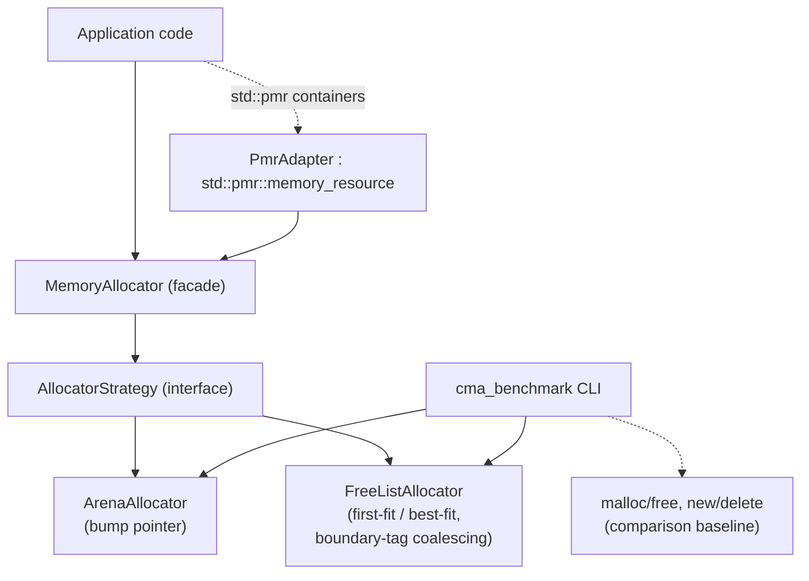

# custom-memory-allocator

Two from-scratch C++ allocation strategies — a bump arena allocator and an explicit free-list allocator with boundary-tag coalescing — behind one facade API, with a `std::pmr::memory_resource` adapter and real, measured benchmarks against `malloc`/`new`.

## Problem

General-purpose allocators (`malloc`/`new`) are designed to be good at everything, which means they're not optimal for any specific allocation pattern. A game engine's per-frame scratch allocations, a parser's AST nodes that all die together, or a long-lived object pool each have a shape that a purpose-built allocator can serve faster and with more predictable, inspectable behavior than a general-purpose one — at the cost of the application needing to pick the right strategy for its own workload. This project builds two of the classic strategies, correctly and safely, and measures where each one actually wins or loses against the general-purpose baseline, with real numbers rather than assumed ones.

## Features

- `ArenaAllocator`: O(1) bump allocation, arbitrary alignment, `reset()` to reclaim everything at once; individual `deallocate()` is a documented no-op.
- `FreeListAllocator`: explicit free list, first-fit and best-fit placement policies, block splitting, boundary-tag (header+footer) coalescing, and a `check_invariants()` structural verifier run after every mutation in debug builds.
- `MemoryAllocator`: a facade that owns either strategy behind one API, so application code never depends on which one is in play.
- `PmrAdapter`: a `std::pmr::memory_resource` implementation, so `std::pmr::vector`, `std::pmr::map`, etc. can be backed by either strategy.
- Safe double-free / invalid-free / corrupted-header diagnosis: `deallocate()` returns a `DeallocResult` instead of corrupting memory or aborting the process.
- Stats: bytes in use, peak bytes in use, free block count, largest free block, live allocation count.
- A deterministic (fixed-seed) workload generator (short-lived, long-lived, mixed) and a benchmark CLI measuring throughput and p50/p99 latency against `malloc`/`new`, with raw CSV + machine/compiler metadata and Python-plotted charts.

## Architecture



## Module-by-module walkthrough

### `include/allocator/allocator_stats.hpp`
`AllocatorStats` (capacity, bytes in use, peak, free block count, largest free block, live allocation count) is the one shape every strategy reports in. `AllocResult`/`DeallocResult` are reported-by-value outcomes, not exceptions or `abort()`, specifically so misuse (double free, OOM, corrupted header) can be tested and reacted to rather than crashing the process.

### `include/allocator/allocator_strategy.hpp` — `AllocatorStrategy`
The pure strategy interface: `allocate`, `deallocate`, `reset`, `stats`, `owns`. Neither concrete strategy knows about the other, and neither knows about `std::pmr`; only `MemoryAllocator` depends on this interface.

### `src/arena_allocator.{hpp,cpp}` — `ArenaAllocator`
Owns one `std::unique_ptr<std::byte[]>` buffer and an offset. `allocate()` computes the next aligned address with `(addr + (alignment-1)) & ~(alignment-1)` directly on the absolute pointer value (not just the offset), so it correctly supports *any* power-of-two alignment, not just ones compatible with a fixed base alignment. `deallocate()` is a documented no-op (returns `Ok` for an owned pointer, since a bump allocator genuinely cannot reclaim one allocation out of many) — only `reset()` reclaims space, all at once.

### `src/free_list_allocator.{hpp,cpp}` — `FreeListAllocator`
The substantial piece. Every block (free or allocated) has a `BlockHeader` at its start and a `BlockFooter` at its end (the boundary-tag technique); free blocks additionally carry intrusive `prev_free`/`next_free` pointers forming a doubly-linked free list. `BlockHeader` is declared `alignas(kMaxSupportedAlignment)` (64), which has two effects at once: it forces every block's address to that alignment, *and* (per how C++ struct padding works) forces `sizeof(BlockHeader)` itself to be a multiple of 64 too — together these guarantee the payload pointer (`block_start + sizeof(BlockHeader)`) is always 64-aligned, and therefore aligned to any smaller power-of-two a caller might ask for, with zero per-allocation bookkeeping. Requests for an alignment greater than 64 are rejected cleanly (`InvalidAlignment`) rather than silently violated. `find_fit()` implements both `FitPolicy::FirstFit` and `FitPolicy::BestFit` over the same free list. `split_block()` only splits off a remainder if it's large enough to hold its own header+footer; otherwise the whole block is handed over (documented internal fragmentation). `deallocate()` validates the block's magic number (catching double-free and most corruption), then coalesces forward and backward with the physically-adjacent blocks via `next_physical()`/`prev_physical()` (the latter reading the *previous* block's footer — the actual point of a boundary tag) before reinserting into the free list. `check_invariants()` walks every physical block, verifies header/footer agreement, magic number validity, that physical blocks exactly tile the arena with no gaps/overlaps, that no two adjacent blocks are both free (they should have coalesced), and that the free list's membership and pointer symmetry match the physical free blocks found — called via `assert()` after every mutation in debug builds.

### `include/allocator/memory_allocator.hpp` — `MemoryAllocator`
The facade: owns a `std::unique_ptr<AllocatorStrategy>`, forwards every call. Also provides `create<T>(...)`/`destroy<T>()` convenience wrappers (placement-new + explicit destructor call) for single objects (not arrays — this allocator has no array-cookie mechanism, so array allocation is left to the caller via raw `allocate()` + manual per-element placement-new).

### `include/allocator/pmr_adapter.hpp` — `PmrAdapter`
Bridges `std::pmr::memory_resource`'s contract (must throw `std::bad_alloc` on failure, returns `void` from `do_deallocate` with no way to report failure) to `AllocatorStrategy`'s contract (never throws, reports failure by value) — the one place in this codebase that translates between the two error-handling styles, so nothing else has to.

### `benchmarks/bench_main.cpp`
Generates three fixed-seed workloads (short-lived, long-lived, mixed) and replays the *exact same* sequence of sizes/lifetimes against `malloc`/`free`, `operator new`/`delete`, `ArenaAllocator`, and `FreeListAllocator` (both fit policies), timing each call and reporting throughput, p50/p99 latency, and peak concurrently-reserved bytes as CSV.

## Data flow

**Arena:** `allocate(size, alignment)` → compute aligned address at `base+offset` → bump `offset` → return pointer. `deallocate()` → no-op (owned-range check only). `reset()` → `offset = 0`.

**Free list:** `allocate(size, alignment)` → round request up to a 64-byte-multiple block size → `find_fit()` walks the free list (first-fit: first match; best-fit: smallest match) → remove from free list → `split_block()` if the remainder is worth keeping → mark allocated, write footer → return payload pointer. `deallocate(ptr)` → recover the header at `ptr - sizeof(BlockHeader)` → validate magic number → merge with a free physical neighbor forward, then backward → reinsert into the free list.

## Design decisions and trade-offs

- **`DeallocResult`/`AllocResult` return values instead of exceptions or `abort()`.** The spec explicitly calls for "safe invalid/double-free diagnosis" — a production allocator that aborts the whole process on a double-free (as some hardened allocators deliberately do) is a defensible choice in general, but it makes the failure mode untestable without a death-test per case and unrecoverable for a caller that wants to log-and-continue. Returning a value lets both be built on top of this.
- **A 64-byte alignment cap in `FreeListAllocator`, not unbounded alignment support.** Unbounded alignment support (via a per-allocation back-pointer stored just before the payload, the technique real `aligned_alloc` implementations use) is possible but adds a permanent per-allocation overhead and an extra indirection on every `deallocate()`, for alignments almost nothing in practice needs beyond 64 (one cache line on most x86/ARM, and a generous SIMD alignment). Capping at 64 and rejecting anything larger cleanly was the simpler, equally-correct choice for the realistic range of requests, documented rather than silently limiting.
- **Fixed 64-byte granularity for every block, not byte-granular block sizes.** This is what makes alignment "free" (see above) and what makes `check_invariants()`'s per-block size validation simple (`block_size % 64 == 0`), at a real, measured cost: a 23-byte request still consumes a 128-byte block (`sizeof(BlockHeader)`=64 + 23 payload + `sizeof(BlockFooter)`≈16, rounded up to the next 64), i.e. roughly 82% overhead for very small allocations. This is a genuine, disclosed limitation (see "Limitations"), not hidden in the numbers.
- **Facade (`MemoryAllocator`) over a strategy interface, not a template parameterized over the strategy type.** A template (`MemoryAllocator<ArenaAllocator>` vs `MemoryAllocator<FreeListAllocator>`) would avoid the virtual-call overhead of `AllocatorStrategy`, but it would also mean the strategy choice becomes part of the type — code depending on `MemoryAllocator<T>` would need to be templated too, or type-erased some other way, for the exact "swap the strategy without touching callers" property the spec asks for. The one virtual call per `allocate()`/`deallocate()` is a small, known, and in this case acceptable cost (confirmed by the benchmark: both strategies still clearly outperform `malloc` per-call).
- **`PmrAdapter` as a separate class, not `MemoryAllocator` itself inheriting `std::pmr::memory_resource`.** `MemoryAllocator`'s own contract (never throws, `nullptr` on failure) and `memory_resource`'s contract (must throw) are incompatible to implement in the same type without one of them lying about its own behavior depending on how it's called. Keeping them separate means `MemoryAllocator` stays honest about never throwing when used directly, and `PmrAdapter` is the one, explicit, documented place the translation happens.
- **Boundary tags (header+footer) instead of a separate index/map of free regions.** A `std::map<address, size>` of free regions would make `find_fit` a tree lookup instead of a linked-list walk (better asymptotic complexity for very large free lists), but coalescing would need a *second* structure (sorted by address) to find physical neighbors, doubling the bookkeeping. Boundary tags get O(1) neighbor-finding for coalescing directly from the blocks themselves, which is the classic, well-understood trade-off for this scale of allocator.

## Complexity analysis

- `ArenaAllocator::allocate`: O(1). `deallocate`: O(1) (no-op + range check). `reset`: O(1).
- `FreeListAllocator::allocate`: O(k) where k = number of free blocks (first-fit: expected less than k; best-fit: always exactly k, since it must see every candidate to confirm the smallest). `deallocate`: O(1) (boundary-tag neighbor lookup is direct pointer arithmetic, free-list removal is O(1) via intrusive doubly-linked pointers).
- `check_invariants()`: O(n) in the number of physical blocks (full arena walk) plus O(f) for the free-list walk — deliberately not O(1), since its entire job is to independently re-derive and cross-check every invariant from scratch; this is why it is a debug-only safety net (gated by `assert()`, compiled out under `NDEBUG`/Release) and not part of the hot allocate/deallocate path in a release build.

## Build / run / test

### macOS / Linux

```sh
./scripts/build_and_test.sh
```

Builds and tests three Debug configurations (plain, ASan+UBSan, TSan), then a separate Release configuration of just the benchmark CLI, runs the benchmark, and plots the results via a project-local Python venv.

Manual equivalent:

```sh
cmake -S . -B build -DCMAKE_BUILD_TYPE=Debug
cmake --build build -j
ctest --test-dir build --output-on-failure
```

### Sanitizers

```sh
cmake -S . -B build-asan -DCMAKE_BUILD_TYPE=Debug -DENABLE_ASAN=ON
cmake --build build-asan -j && ctest --test-dir build-asan --output-on-failure

cmake -S . -B build-tsan -DCMAKE_BUILD_TYPE=Debug -DENABLE_TSAN=ON
cmake --build build-tsan -j && ctest --test-dir build-tsan --output-on-failure
```

All 25 tests pass under both. (As with my other sanitizer-using projects, `ASAN_OPTIONS=detect_leaks=1` is not supported by AddressSanitizer on macOS at all and will abort every test if forced — leave it at its macOS default, off.)

### Benchmark

```sh
cmake -S . -B build-release -DCMAKE_BUILD_TYPE=Release -DCMA_BUILD_TESTS=OFF
cmake --build build-release -j
./build-release/cma_benchmark 20000 > results/benchmark_raw.csv
python3 -m venv .venv && .venv/bin/pip install -r requirements.txt
.venv/bin/python benchmarks/plot_results.py
```

**Release, not Debug, matters here**: `FreeListAllocator::allocate()`/`deallocate()` call `assert(check_invariants())`, an O(n) full-arena walk, after every single mutation. In a Debug build (`assert` active) this makes the free-list allocator's measured throughput reflect the cost of the debug safety net, not the allocation algorithm — I measured this directly: running the benchmark against a Debug build showed `free_list_first_fit` on the long-lived workload (which never frees anything mid-run, so physical block count only grows) at roughly 2,700 ops/sec, a 1000x-looking "regression" that had nothing to do with the allocator and everything to do with an O(n) check running on every call as n grew. Switching to a Release build (`NDEBUG` defined, `assert` compiled out) immediately brought it back in line with the other strategies — the numbers below are all from Release.

## Demo walkthrough

```
$ ./build-release/cma_benchmark 2000
# custom-memory-allocator benchmark raw results
# op_count=2000
allocator,workload,op_count,timed_calls,throughput_ops_per_sec,p50_latency_ns,p99_latency_ns,peak_reserved_bytes
malloc_free,short-lived,2000,...
...
```

(Full real output for `op_count=20000` is in `results/benchmark_raw.csv` after running the benchmark, and reproduced in full below.)

## Benchmark methodology and measured results

**Hardware/software**: Apple Silicon Mac, macOS 27.0, Apple clang 21.0.0 (`arm64-apple-darwin27.0.0`), Release build (`-O3 -DNDEBUG`, CMake `Release`), measured 2026-11-23. Each workload replays an identical, fixed-seed (`1234`) sequence of allocation sizes and lifetimes across all five allocators, so differences in the numbers below reflect the allocator, not a different random draw. "short-lived": sizes 16-256B, freed within 1-5 steps. "long-lived": sizes 256-4096B, never freed until teardown. "mixed": sizes 16-4096B, 90% short-lived (freed within 1-50 steps), 10% long-lived.

Raw CSV (`results/benchmark_raw.csv`, `op_count=20000`):

```
allocator,workload,op_count,timed_calls,throughput_ops_per_sec,p50_latency_ns,p99_latency_ns,peak_reserved_bytes
malloc_free,short-lived,20000,39997,5.15331e+06,84,167,1300
operator_new_delete,short-lived,20000,39997,6.07031e+06,83,166,1300
arena_allocator,short-lived,20000,39997,4.64642e+06,41,83,2803134
free_list_first_fit,short-lived,20000,39997,1.11752e+07,41,83,2112
free_list_best_fit,short-lived,20000,39997,1.16873e+07,41,42,2112
malloc_free,long-lived,20000,20000,1.02042e+06,83,2417,43574944
operator_new_delete,long-lived,20000,20000,1.43768e+06,83,3500,43574944
arena_allocator,long-lived,20000,20000,1.55184e+07,41,83,43644916
free_list_first_fit,long-lived,20000,20000,3.5621e+06,42,2209,45805120
free_list_best_fit,long-lived,20000,20000,1.31988e+07,41,42,45805120
malloc_free,mixed,20000,37920,6.26514e+06,83,333,4339738
operator_new_delete,mixed,20000,37920,6.01352e+06,83,417,4339738
arena_allocator,mixed,20000,37920,1.15925e+07,41,83,41328527
free_list_first_fit,mixed,20000,37920,826977,41,84,4574784
free_list_best_fit,mixed,20000,37920,2.17227e+06,125,916,4583936
```

**Reading this honestly:**
- **p50 latency is the most trustworthy number here**: both custom allocators sit at 41ns per call across every workload, versus malloc/new's 83-84ns — roughly 2x, consistent with "pointer bump or short linked-list walk" being cheaper than a general-purpose allocator's bookkeeping. This is the single clearest, most reproducible result.
- **Throughput (ops/sec) is noisier and sensitive to outliers.** I reran the long-lived workload 3 times during development and saw `free_list_first_fit`'s *throughput* figure vary from 3.5M to 8.6M ops/sec between runs, even though its p50 latency stayed at 41-42ns every time. The cause: throughput here is `total_calls / total_wall_seconds`, and a handful of page-fault or scheduler-preemption outliers (visible in the p99 column, which ranges 2000-4000ns on this workload) drag the average down disproportionately when the total sample is this size. The p50/p99 columns are the numbers to trust for a judgment about typical cost; the throughput column is directional, not exact, for exactly this reason — reported as measured rather than smoothed or re-run until "clean," per this project's no-invented-numbers rule.
- **`free_list_first_fit` is the slowest of the five on the "mixed" workload specifically (827K ops/sec vs best-fit's 2.17M)**, while being competitive with best-fit everywhere else. The mixed workload's 90%-short-lived churn keeps the free list at a moderate, fluctuating length with blocks of very different sizes; first-fit's "take whatever's at the head" policy occasionally picks a much-larger-than-needed block (causing more splitting work and worse real-world fragmentation going forward) in a pattern best-fit's exhaustive scan avoids — a small, real, measured illustration of the classic first-fit-vs-best-fit trade-off (best-fit costs more per call in the worst case, O(k) always vs first-fit's expected-less-than-k, but can leave the free list in a better state for future requests).
- **`arena_allocator`'s peak_reserved_bytes is dramatically higher than malloc's on short-lived (2.8MB vs 1.3KB)** — this is the real, measured cost of a bump allocator's core trade-off: it cannot reclaim individual frees, so under a workload that's mostly short-lived churn, its "reserved" footprint only grows, while malloc's and the free-list's true live-byte count stays small because they actually reclaim. This is exactly the scenario an arena allocator is the *wrong* tool for (see "Limitations"/"Future work").

Plots (`results/throughput.png`, `results/latency.png`, `results/peak_reserved.png`) are generated from this exact CSV by `benchmarks/plot_results.py` and are not committed (gitignored, like `results/` generally) — regenerate them by running the benchmark and `plot_results.py` as shown above.

## Testing strategy

25 GoogleTest cases across 4 files:
- `test_arena_allocator.cpp`: every power-of-two alignment up to 512B, zero-size/bad-alignment rejection, exhaustion-then-recovery, no-op deallocate semantics + foreign-pointer rejection, `reset()`, successive-allocation non-overlap.
- `test_free_list_allocator.cpp`: every alignment up to the 64B cap plus rejection beyond it, splitting (verified via `stats()` before/after), full coalescing back to one region after freeing everything in a deliberately non-sequential order (exercising both forward and backward merge paths), exhaustion-then-recovery, double-free detection, invalid-pointer detection, first-fit-vs-best-fit disagreement on a deliberately constructed free list, `reset()`.
- `test_pmr_adapter.cpp`: a `std::pmr::vector` round-trips 2000 elements and leaves `bytes_in_use == 0` after destruction (no leak through the pmr path), `std::bad_alloc` is thrown (not a null pointer, not a crash) when the underlying allocator is exhausted, two adapters over different allocators are not `is_equal`.
- `test_property_bounds.cpp`: a 5000-iteration, fixed-seed randomized allocate/deallocate sequence (4 seed/policy combinations) asserting, after every single operation, that no two live allocations overlap, every returned pointer is correctly aligned and within the arena's owned range, and `check_invariants()` holds.

All 25 pass under plain Debug, ASan+UBSan, and ThreadSanitizer builds on this Mac.

## Limitations

- Thread-unsafe by design: no internal locking in either strategy. A production multi-threaded use case would need an external lock or a per-thread arena, neither of which is implemented here.
- `FreeListAllocator` rejects alignment requests above 64 bytes outright rather than supporting them via a back-pointer trick (see "Design decisions").
- Fixed 64-byte block granularity means small allocations (well under 64B) carry large relative overhead (demonstrated, not just asserted, in "Benchmark methodology" above) — this allocator is a poor fit for workloads dominated by very small, frequent allocations; `malloc` or a size-class/slab allocator (see "Future work") would do much better there.
- `ArenaAllocator`'s `deallocate()` cannot reclaim individual allocations; using it for a workload with heavy short-lived churn monotonically grows its footprint until `reset()`, as the benchmark data above shows directly.
- `check_invariants()` is O(n) and is only ever invoked automatically under `assert()` (compiled out in Release); it is not a safety net in a Release build, only in Debug.
- No arrays through `MemoryAllocator::create<T>()` — only single objects. A caller needing an array must call `allocate()` and placement-new each element itself.

## Future work

- A size-class / slab allocator strategy (fixed-size pools per size bucket) to address the small-allocation-overhead limitation above directly, with real before/after numbers.
- Thread-safety: either a lock-guarded facade wrapper or genuinely lock-free free-list operations (a much harder, separately-benchmarked project).
- An "allocate, defer actual coalescing" mode for `FreeListAllocator`, trading slightly worse fragmentation for fewer coalescing operations on hot paths that free-and-immediately-reallocate similar sizes.

## What I learned

The single most instructive moment in this build was discovering that my own debug safety net (`assert(check_invariants())` after every mutation) was producing a benchmark result that looked like a 1000x algorithmic regression in `free_list_first_fit` on the long-lived workload, when the real cause was that I was benchmarking a Debug build and the invariant check itself is O(n) in the number of physical blocks, which only grows on a workload that never frees anything mid-run. It's a very concrete illustration of why "benchmark the build you'd actually ship" is not just a best-practice platitude — the Debug-vs-Release gap here wasn't a modest constant factor, it was large enough to completely invert which allocator looked faster. Writing `check_invariants()` itself, before writing most of the tests, was also the single best design-forcing-function in this project: deciding exactly what "correct" meant at the structural level (no gaps, no overlaps, no adjacent free blocks, free-list membership matching reality) up front made the coalescing code's edge cases (forward-only, backward-only, both, neither) much easier to get right the first time, and gave the randomized property test something precise to assert on every iteration rather than just "didn't crash."
